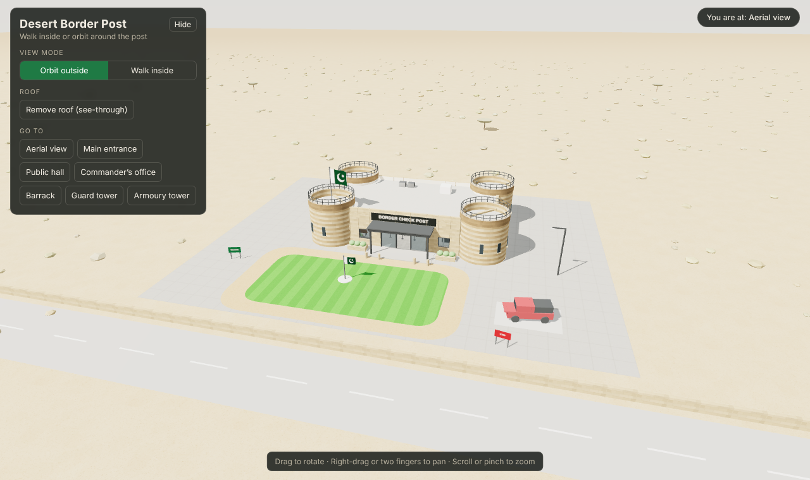
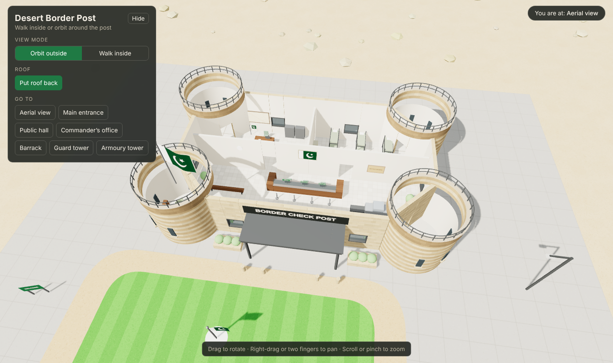

# Desert Border Post – interactive 3D model

A Three.js model of the border post from the reference image: central stone hall with
an entrance canopy, four round corner towers with railings, the national flag, the lawn
and track in front, parked pickup, signs, boundary wall and desert scrub.

Open `index.html` in any modern browser (it loads Three.js from the jsDelivr CDN).

## Controls
- **Orbit outside** – drag to rotate, right-drag / two fingers to pan, scroll / pinch to zoom.
- **Walk inside** – `W A S D` or arrow keys to walk, drag to look, `Shift` to run.
  On phones, use the on-screen arrows. Walls and furniture block movement; doorways are open.
- **Remove roof** – lifts the roof off so you can look down into every room.
- **Go to** – jump to the aerial view, main entrance, public hall, commander's office,
  barrack, guard tower or armoury tower.

## Layout
| Area | Contents |
|---|---|
| Public hall (front) | Immigration counter, queue posts, waiting benches, baggage scanner, metal detector |
| Commander's office (back left) | Desk, chairs, sofa, filing cabinets, wall map |
| Barrack (back right) | Bunk beds, lockers, table |
| Towers | Armoury (front left, flag on top), Guard (front right), Records (back left), Store (back right) |

